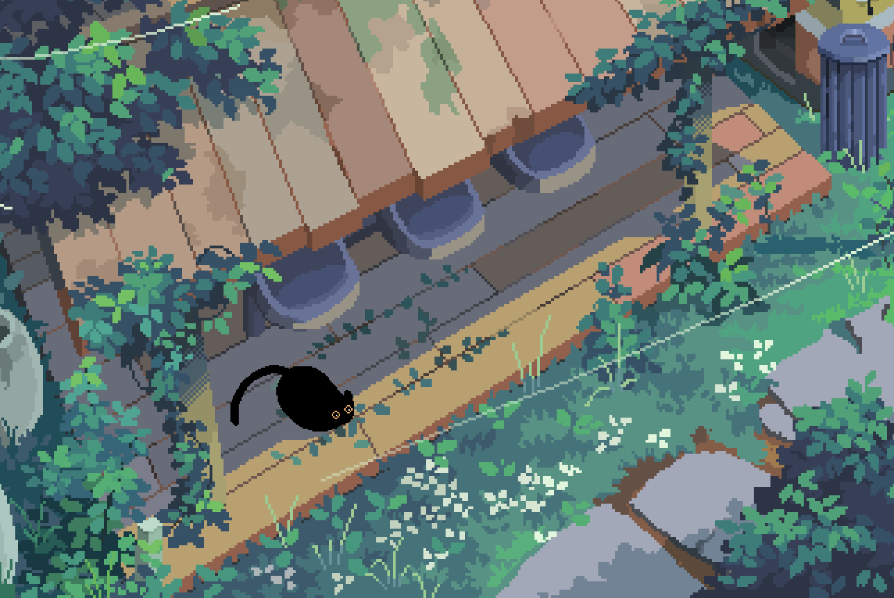

<h1 data-importer="text" align="left">Hey 👋 What's up?</h1>

<h2 data-importer="text" align="left">About Me</h2>

 

  #### 🔭 I'm Informatics Student  
  #### 🔭 I’m studying at Tadulako University  
  #### ⚡ I'm Part of [**Robotech Tadulako**](https://www.instagram.com/robotech_tadulako/)  
  #### 😄 Interest in Back-end & Robotics

 ## I learn 

  
  
  
  
  
  
  
  
  
  
  
  
  

 
 ## Other
 
 

## Play a Game
<picture data-importer="pacman">
  <source media="(prefers-color-scheme: dark)" srcset="https://raw.githubusercontent.com/AzizaHijran/AzizaHijran/pacman-output/pacman-contribution-graph-dark.svg?game=pacman">
  <source media="(prefers-color-scheme: light)" srcset="https://raw.githubusercontent.com/AzizaHijran/AzizaHijran/pacman-output/pacman-contribution-graph.svg?game=pacman">
  
</picture>

<!--
**AzizaHijran/AzizaHijran** is a ✨ _special_ ✨ repository because its `README.md` (this file) appears on your GitHub profile.

- 🔭 I’m currently working on ...
- 🌱 I’m currently learning ...
- 👯 I’m looking to collaborate on ...
- 🤔 I’m looking for help with ...
- 💬 Ask me about ...
- 📫 How to reach me: ...
-  Pronouns: ...
- ⚡ Fun fact: ...
-->
